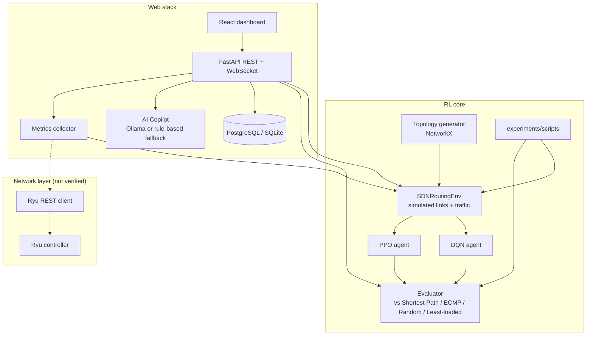
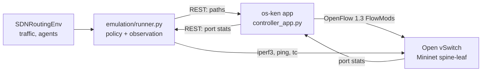

# RL-SDN Traffic Engineering

Reinforcement-learning agents (DQN and PPO) that choose routing paths for flows in a simulated
software-defined network, plus a FastAPI backend and React dashboard around them, and an emulation
harness that runs the same policies on a Mininet network through an OpenFlow controller.

> **Work in progress.**
> The simulated environment, the agents, the backend and the dashboard run, and the backend tests
> pass. In the [second experiment](experiments/second_experiment/README.md) (simulation), DQN and
> PPO deliver more traffic than shortest-path, ECMP and random routing, but less than a simple
> least-loaded heuristic. In the [Mininet experiment](experiments/mininet_experiment/README.md), the
> same trained models run without retraining on an emulated network (Mininet, Open vSwitch,
> os-ken (maintained Ryu fork)), and the ranking against the baselines mostly holds.
> See [STATUS.md](STATUS.md) for exactly what was checked.

[](https://github.com/amirhosseinkho/RL-SDN-Traffic-Engineering/actions)
[](https://www.python.org/downloads/)
[](LICENSE)

---

## What the project does today

1. A topology generator builds a NetworkX graph (linear, tree, fat-tree, spine-leaf or custom JSON).
2. `SDNRoutingEnv` (a Gymnasium environment) simulates link utilization, queueing, latency and
   packet loss on that graph, from a randomly generated and randomly perturbed set of flows.
3. At each step, a DQN or PPO agent picks one of the K shortest paths for every flow, and the
   environment returns a reward based on how much of the demand is delivered and how long the
   flows' paths take.
4. An evaluator compares trained agents with shortest-path, ECMP, random and least-loaded routing
   in the same simulation, on the same traffic.
5. A FastAPI backend and a React dashboard let you create topologies, watch simulated link metrics,
   start training runs and compare agents.
6. The `emulation/` package builds the same topology in Mininet, runs an os-ken controller app,
   generates the simulator's traffic with iperf3, builds the agents' observation from measured port
   and queue statistics, and installs each policy's routing as OpenFlow rules every epoch.

Training happens only in the simulation. The backend and dashboard do not install routes on
switches; only the emulation runner does.

---

## Architecture

Solid arrows are code paths that have been run (see [STATUS.md](STATUS.md)). Dashed arrows are
code that exists but has not been run against a real controller.



The metrics collector reads from Ryu when a controller is reachable. Otherwise it simulates the
active topology, and that is what the Live Metrics page shows.

The emulation is separate from the backend:



Details, decisions and the feature mapping are in [docs/emulation.md](docs/emulation.md).

---

## Project Structure

```
RL-SDN-Traffic-Engineering/
├── backend/
│   ├── app/
│   │   ├── config.py               # Settings (pydantic-settings)
│   │   ├── main.py                 # FastAPI app factory + lifespan
│   │   ├── api/
│   │   │   ├── routes/             # topology, metrics, flows, rl, reports, copilot
│   │   │   └── websocket.py        # /ws/metrics, /ws/training/{session_id}
│   │   ├── controller/
│   │   │   ├── ryu_controller.py   # Async HTTP client for Ryu's REST API
│   │   │   ├── flow_rules.py       # Per-flow OpenFlow rules: hops, cookies, update plan, FlowMods
│   │   │   └── openflow_handler.py # os-ken/Ryu app (OpenFlow 1.3, L2 learning)
│   │   ├── database/               # SQLAlchemy models, Pydantic schemas, session
│   │   ├── monitoring/
│   │   │   └── collector.py        # Metrics from Ryu, or from a simulation of the active topology
│   │   ├── rl/
│   │   │   ├── environment.py      # SDNRoutingEnv (Gymnasium)
│   │   │   ├── trainer.py          # DQN and PPO training loops, seeding
│   │   │   └── agents/
│   │   │       ├── dqn_agent.py    # Dueling Double DQN, uniform replay buffer
│   │   │       └── ppo_agent.py    # PPO (clipped objective, GAE-Lambda)
│   │   ├── simulation/
│   │   │   ├── traffic_generator.py # Traffic patterns (standalone, not used by the env)
│   │   │   └── evaluator.py         # Agents vs shortest path / ECMP / random / least-loaded
│   │   └── topology/
│   │       └── generator.py        # Linear, tree, fat-tree, spine-leaf, custom JSON
│   ├── tests/
│   │   ├── unit/                   # pytest unit tests
│   │   └── integration/            # API tests (in-memory SQLite)
│   ├── requirements.txt
│   └── Dockerfile
├── frontend/
│   ├── eslint.config.js
│   └── src/
│       ├── components/             # TopologyGraph, TrainingChart, MetricsCards, Sidebar
│       ├── pages/                  # 8 dashboard pages
│       ├── services/               # REST + WebSocket clients
│       ├── store/                  # Zustand store
│       └── types/
├── emulation/                      # Mininet + os-ken: topology, controller app, runner, analysis
│   └── tests/                      # unit tests; one Mininet integration test (root only)
├── experiments/
│   ├── first_experiment/           # old reward (superseded): run.sh, results, write-up
│   ├── second_experiment/          # per-flow reward: run.sh, results, write-up
│   ├── mininet_experiment/         # the second experiment's policies on Mininet: run.sh, raw runs, write-up
│   └── scripts/
│       ├── train_dqn.py
│       ├── train_ppo.py
│       └── evaluate.py
├── models/                         # Trained weights are written here (git-ignored)
├── docs/                           # architecture.md, training.md, emulation.md
├── STATUS.md                       # What has been verified
├── docker-compose.yml
└── .github/workflows/            # ci.yml; emulation.yml (manual, Mininet integration test)
```

---

## Features

### Implemented and verified
Exercised by the tests, by running the scripts, or by using the dashboard (see [STATUS.md](STATUS.md)).

- **Topology generator**: linear, tree, fat-tree (k-port), spine-leaf and custom JSON topologies,
  with per-link bandwidth, latency and loss attributes.
- **`SDNRoutingEnv`** (Gymnasium API):
  - *State*: per-link utilization, latency, packet loss and queue occupancy; per-flow demand and
    active flag; global average/max utilization and congestion ratio.
  - *Action*: multi-discrete, one of the K shortest paths (K = 4 by default) per flow.
  - *Reward*: `delivered_ratio − 0.1·(mean_stretch − 1)`: the share of total demand delivered
    (overloaded links are shared in proportion to demand), minus a penalty for flow latency above the
    uncongested shortest-path latency. See [docs/architecture.md](docs/architecture.md#reward-function).
  - Traffic is synthetic: about 20% elephant flows; demand fluctuates and bursts around each flow's
    base demand.
- **DQN agent**: dueling network, Double-DQN targets, uniform experience replay, epsilon-greedy
  exploration, checkpointing.
- **PPO agent**: shared trunk with one policy head per flow, value head, GAE-Lambda advantages,
  clipped surrogate objective.
- **Reproducible runs**: `--seed` seeds Python, NumPy, PyTorch and the simulated traffic;
  `--output-dir` chooses where models are saved.
- **Evaluation** against shortest-path, ECMP, random and least-loaded routing, reporting reward,
  delivered demand, flow latency and link utilization, written to JSON.
- **FastAPI backend**: REST routes for topologies, metrics, flows, training sessions, evaluation,
  reports (JSON, CSV, PDF) and the copilot; a WebSocket stream for live metrics.
- **React dashboard**: Topology, Live Metrics, RL Training, Training Progress and Evaluation pages
  were used against the running backend.
- **AI Copilot**: sends questions to an Ollama model, and falls back to fixed keyword-based answers
  (labelled `rule-based`) when Ollama is unavailable. Only the fallback has been tested.

- **Emulation (Mininet)**: the spine-leaf topology in Mininet with Open vSwitch (OpenFlow 1.3),
  shaped switch links (htb + netem), an os-ken (maintained Ryu fork) controller app with a REST
  API, LLDP link discovery checked against the topology mapping, port statistics every second,
  and per-flow IPv4 rules (cookies, egress-first updates, barriers). The runner drives any of
  the six policies epoch by epoch, with iperf3 UDP traffic from the simulator's traffic model and
  observations built from measurements. Paths are checked with tshark, and links can be
  degraded at runtime (netem stress test). See [docs/emulation.md](docs/emulation.md).
- **Path installation helpers**: `FlowManager.install_path` was run against Ryu 4.34's
  `ofctl_rest` and fixed (it misread Ryu's hex datapath IDs and skipped the egress switch).

### Implemented but not verified
- **Ryu integration in the backend**: the async client for Ryu's REST API (topology, flow and port
  stats) used by the metrics collector and flow routes. os-ken does not ship this REST API; only
  `FlowManager` was run against Ryu 4.34.
- **Mininet CI job** (`.github/workflows/emulation.yml`, manual trigger): not run; hosted runners
  may not allow the Open vSwitch kernel module.
- **Active Flows, Reports and AI Copilot pages** of the dashboard: their API endpoints were tested,
  but the pages themselves were not opened.
- **Training-progress WebSocket** (`/ws/training/{session_id}`): the dashboard reads training
  progress from the REST API instead, so this stream has not been used.
- **Docker images** and `docker compose up`.

### Planned
- Per-flow, per-path features in the observation, so the agents can see what the least-loaded
  heuristic uses (see the [second experiment](experiments/second_experiment/README.md)).
- A simulator link model with per-direction capacity and downstream thinning (see the
  [Mininet experiment](experiments/mininet_experiment/README.md#the-gap-between-simulator-and-emulation)).
- Training or fine-tuning against the emulated network; TCP traffic in the emulation.
- Installing routes from the backend API (`POST /flows/install` only records a flow).

---

## Quick Start

Tested on Ubuntu 24.04 (WSL2) with Python 3.12.3 and Node 22.

### Backend

```bash
git clone https://github.com/amirhosseinkho/RL-SDN-Traffic-Engineering.git
cd RL-SDN-Traffic-Engineering/backend
python3.12 -m venv .venv
source .venv/bin/activate
pip install -r requirements.txt
DATABASE_URL="sqlite+aiosqlite:///./sdn.db" uvicorn app.main:app --port 8000
```

On a CPU-only machine, first run
`pip install torch==2.5.1 --index-url https://download.pytorch.org/whl/cpu` to skip the CUDA build.
Without `DATABASE_URL`, the backend expects PostgreSQL at the address in `.env.example`.
API docs: `http://localhost:8000/api/v1/docs`.

### Dashboard

```bash
cd frontend
npm ci
npm run dev
```

Open `http://localhost:3000`. The dev server proxies `/api` and `/ws` to port 8000. Create a
topology, click **Set Active**, and the Live Metrics page will show the simulated link state.

### Docker

`docker compose up -d` is the intended way to run everything (dashboard on port 3000, API on 8000),
but the images have not been built and tested yet.

---

## Training and Evaluation from the CLI

Run from the repository root.

```bash
# Train DQN on a spine-leaf topology
python experiments/scripts/train_dqn.py \
    --topology spine_leaf --num-switches 6 --num-hosts 8 \
    --timesteps 300000 --seed 0 --output-dir models/seed_0

# Train PPO on the same topology
python experiments/scripts/train_ppo.py \
    --topology spine_leaf --num-switches 6 --num-hosts 8 \
    --timesteps 300000 --seed 0 --output-dir models/seed_0

# Compare with shortest path, ECMP, random and least-loaded routing on the same topology
python experiments/scripts/evaluate.py \
    --topology spine_leaf --num-switches 6 --num-hosts 8 \
    --dqn-model models/seed_0/dqn_model.pt \
    --ppo-model models/seed_0/ppo_model.pt \
    --episodes 20 --seed 1000 \
    --output results/comparison.json
```

A model can only be evaluated on the topology it was trained on, because the observation size
depends on the topology.

### Emulation (Mininet)

Linux only (tested on WSL2 with Ubuntu 24.04), as root. Setup (Mininet, Open vSwitch, iperf3,
tshark, os-ken, kernel modules) is in [docs/emulation.md](docs/emulation.md#environment-setup).
Run from the repository root with the backend's virtualenv:

```bash
# One policy, 20 epochs of 10 s, on traffic seed 1000
sudo ~/venvs/rlsdn/bin/python -m emulation.runner --policy dqn --model models/seed_0/dqn_model.pt \
    --traffic-seed 1000 --epochs 20 --out results/emu_dqn

# The whole Mininet experiment (39 runs, about 2.5 h), then its tables and figure
sudo bash experiments/mininet_experiment/run.sh ~/venvs/rlsdn/bin/python models
python -m emulation.analyze experiments/mininet_experiment
```

`--policy` is one of `shortest_path`, `ecmp`, `random`, `least_loaded`, `dqn`, `ppo`; `run.sh`
expects `<models dir>/seed_{0,1,2}/{dqn,ppo}_model.pt`.

---

## Results

### Simulation

**[Second experiment](experiments/second_experiment/README.md)** (current reward). Spine-leaf
(6 switches, 8 hosts), 300,000 training steps, 3 seeds per agent, 20 evaluation episodes on traffic
not seen in training, mean ± std across seeds:

| Agent | Episode reward | Delivered demand (%) | Mean flow latency (ms) |
|---|---|---|---|
| Shortest path | 79.9 ± 0.0 | 63.1 ± 0.0 | 32.27 ± 0.00 |
| ECMP | 31.5 ± 0.0 | 56.0 ± 0.0 | 49.38 ± 0.00 |
| Random | 58.6 ± 0.0 | 65.5 ± 0.0 | 45.43 ± 0.00 |
| Least-loaded (heuristic) | 144.3 ± 0.0 | 88.4 ± 0.0 | 25.46 ± 0.00 |
| DQN | 124.6 ± 1.7 | 80.8 ± 0.7 | 27.71 ± 0.11 |
| PPO | 106.9 ± 9.2 | 75.1 ± 1.9 | 30.89 ± 2.70 |

Both agents beat shortest path, ECMP and random routing on every seed; neither reaches the
least-loaded heuristic, which knows each flow's candidate paths while the agents' observation does not.

**[First experiment](experiments/first_experiment/README.md)** (superseded). With the original
utilization-based reward, and a traffic model in which demand grew without bound during each
episode, the trained agents scored no better than random routing. That led to the current reward
and traffic model.

### Emulation (Mininet)

**[Mininet experiment](experiments/mininet_experiment/README.md).**
- **Setup:** the second experiment's models (3 seeds each) and the four baselines, deployed without
  retraining. The network is Mininet + Open vSwitch + os-ken (maintained Ryu fork), with switch
  links scaled to 10 Mbit/s and the simulator's traffic as iperf3 UDP.
- **Runs:** 3 traffic seeds × 20 epochs of 10 s each, 30 runs.
- **Comparison:** the simulator column runs the same policies on the same traffic. Mean ± std
  across runs.

| Policy | Simulator, same traffic: delivered (%) | Emulation: delivered (%) | Emulation: p95 RTT (ms) | Emulation: FlowMods / epoch |
|---|---|---|---|---|
| Shortest path | 60.0 ± 32.2 | 68.0 ± 26.7 | 36.4 ± 12.8 | 0.0 |
| ECMP (5-tuple hash) | 76.4 ± 20.5 | 79.1 ± 18.7 | 32.4 ± 9.0 | 1.9 |
| Random | 66.3 ± 28.3 | 75.1 ± 21.7 | 62.1 ± 21.2 | 68.6 |
| Least-loaded (heuristic) | 83.0 ± 18.7 | 87.6 ± 11.7 | 37.8 ± 2.8 | 24.3 |
| DQN | 75.5 ± 20.9 | 80.7 ± 14.9 | 45.0 ± 11.9 | 22.1 |
| PPO | 71.5 ± 21.8 | 75.5 ± 18.9 | 46.0 ± 12.1 | 14.1 |

- **Ranking:** the rank correlation between simulator and emulation is 0.94. Least-loaded stays
  first and shortest path last. DQN and ECMP swap places, but they are within 2 points of each
  other in both settings, much less than the spread between traffic seeds.
- **Delivered demand:** every policy delivers more in the emulation. The simulator shares one
  link capacity between both directions and does not remove dropped traffic from downstream
  links. Without these two simplifications, a fluid model matches the emulation to within 0.27
  points on average.
- **Stress test:** with a link degraded at runtime (+20 ms, 2% loss), neither least-loaded nor
  DQN consistently moved traffic off it.

---

## API Reference

All routes are under `/api/v1` except the WebSocket streams. Interactive docs are at `/api/v1/docs`.

```
POST   /api/v1/topology/                    Create topology
GET    /api/v1/topology/                    List topologies
GET    /api/v1/topology/{id}                Get topology
GET    /api/v1/topology/{id}/graph          Graph data for visualization
POST   /api/v1/topology/{id}/activate       Set active topology (also drives simulated metrics)
DELETE /api/v1/topology/{id}                Delete topology

GET    /api/v1/metrics/summary              Current network summary
GET    /api/v1/metrics/links                Per-link metrics
GET    /api/v1/metrics/{id}/history         Link metric history
GET    /api/v1/metrics/{id}/congestion      Congestion heatmap

GET    /api/v1/flows/                       List flows
GET    /api/v1/flows/ryu                    Flows reported by Ryu
POST   /api/v1/flows/install                Record a flow (database only)
DELETE /api/v1/flows/{flow_id}              Remove flow
GET    /api/v1/flows/stats/summary          Flow statistics

POST   /api/v1/rl/train                     Start training session
POST   /api/v1/rl/train/{id}/stop           Stop training
GET    /api/v1/rl/sessions                  List sessions
GET    /api/v1/rl/sessions/{id}             Training progress
POST   /api/v1/rl/evaluate                  Run evaluation
GET    /api/v1/rl/compare/{topology_id}     Comparison results

POST   /api/v1/reports/generate             Export report (json / csv / pdf)

POST   /api/v1/copilot/query                Ask a network question
GET    /api/v1/copilot/history              Query history

WS     /ws/metrics                          Live metrics stream
WS     /ws/training/{session_id}            Training progress stream
```

---

## Testing

```bash
cd backend
pytest tests/

cd ../emulation
pytest                      # unit tests, no Mininet needed
sudo <venv>/bin/python -m pytest -m mininet   # integration test: root, Mininet, OVS, iperf3, tshark, os-ken
```

68 backend tests (58 unit, 10 integration on in-memory SQLite) with a 60% coverage gate; one unit
test is skipped unless os-ken is installed. 35 emulation tests; the Mininet integration test is
skipped unless run as root on Linux with Mininet installed. CI runs `ruff` on the backend and
`emulation/`, both test suites, and `npm run lint`, `npm run typecheck` and `npm run build` on the
frontend.

---

## Tech Stack

| Layer | Technology |
|-------|-----------|
| RL | PyTorch, Gymnasium, NumPy |
| Graph / simulation | NetworkX |
| Backend | Python 3.12, FastAPI, SQLAlchemy (async), asyncpg / aiosqlite |
| Controller | os-ken (maintained Ryu fork) app for the emulation; Ryu REST API client in the backend (not verified against a live controller) |
| Emulation | Mininet 2.3, Open vSwitch 3.3, tc htb + netem, iperf3, tshark |
| Frontend | React 18, TypeScript, TailwindCSS, Zustand |
| Charts | Recharts, D3.js |
| AI Copilot | Ollama (optional), rule-based fallback |
| Deployment (not verified) | Docker, Docker Compose |
| CI | GitHub Actions |

---

## License

MIT License. See [LICENSE](LICENSE).

---

## Citation

If you refer to this software, you can cite the repository:

```bibtex
@software{rl_sdn_traffic_engineering,
  title  = {RL-SDN Traffic Engineering},
  author = {Amirhossein Khoshbakht},
  year   = {2026},
  url    = {https://github.com/amirhosseinkho/RL-SDN-Traffic-Engineering}
}
```
