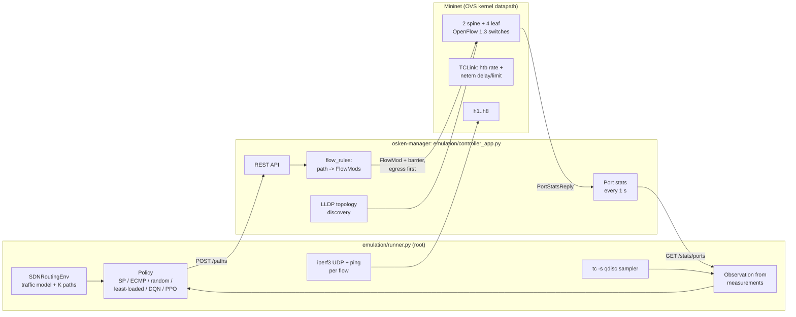

# Emulation: Mininet + os-ken

This document describes how the routing policies are run on an emulated network: what was built,
how to set it up, the decisions taken, and how the emulation differs from the simulator.
Results are in [experiments/mininet_experiment/](../experiments/mininet_experiment/README.md).

## Architecture



Modules (all under `emulation/`, none imported by the backend):

| Module | Needs | Purpose |
|---|---|---|
| `mapping.py` | backend only | Simulator names → Mininet names, dpids, port numbers, interfaces, scaled capacities; written to `mapping.json` for every run |
| `topology.py` | Mininet, root | Builds the network from the mapping |
| `controller_app.py` | os-ken or Ryu | OpenFlow 1.3 app: drop table-miss, path rules, port stats, REST API |
| `controller_client.py` | stdlib | REST client; starts `osken-manager` |
| `session.py` | Mininet, root | Controller + network lifecycle; checks that LLDP discovery matches the mapping |
| `traffic.py` | Mininet for running, parsing is pure | iperf3 UDP flows and pings |
| `verify_paths.py` | tshark for capturing, checking is pure | Checks captured packets against installed paths |
| `milestone.py` | everything | Controller milestone (phase 1) |
| `measure.py` | pure, plus tc/`/proc/stat` sampler threads | Port counters and qdisc samples → simulator link features |
| `observation.py` | backend only | Writes measured features into `SDNRoutingEnv` and calls its `_get_observation()` |
| `policies.py` | backend only | Shortest path, ECMP, random, least-loaded, DQN, PPO behind one `select(env, obs)` |
| `churn.py` | backend only | Rule changes for a path change (same plan as the controller) |
| `runner.py` | everything | One policy × one traffic seed × N epochs |
| `sim_matched.py` | backend only | Same policies in the simulator on the same traffic |
| `analyze.py` | matplotlib | Tables and figure |

The rule logic shared with the backend is `backend/app/controller/flow_rules.py` (pure Python).

## Environment setup

Tested on WSL2 (kernel 6.18.54.1-microsoft-standard-WSL2), Ubuntu 24.04.1, Python 3.12.3.

```bash
# Kernel modules (not loaded automatically after a WSL restart)
printf 'openvswitch\nsch_htb\nsch_netem\nsch_tbf\n' | sudo tee /etc/modules-load.d/mininet.conf
sudo modprobe -a openvswitch sch_htb sch_netem sch_tbf

# Mininet 2.3.0, Open vSwitch 3.3.9, iperf3 3.16, tshark 4.2.2, os-ken 2.8.1 (Ubuntu 24.04 packages)
sudo apt install mininet openvswitch-switch openvswitch-testcontroller iperf3 tshark python3-os-ken

sudo mn --link tc --test pingall
```

`modprobe` loads only its first argument unless given `-a`; the other names are taken as module
parameters (`modprobe openvswitch sch_htb ...` loads only `openvswitch`).

`openvswitch-switch` starts under WSL with systemd enabled (`systemctl is-active openvswitch-switch`
→ `active`).

The runner needs root (Mininet) and the backend's Python packages. It is run with the backend
virtualenv's interpreter under `sudo`; the apt package installs Mininet for the system Python only,
so `emulation/_compat.py` appends `/usr/lib/python3/dist-packages` to `sys.path` (after the
virtualenv's own packages) when `import mininet` fails. The controller runs under the system
Python (`/usr/bin/osken-manager`).

## Decisions

### Controller: os-ken

- **os-ken 2.8.1** from Ubuntu's `python3-os-ken` runs on the system Python 3.12 and has Ryu's API
  under `os_ken.*`; the entry point is `osken-manager` (checked in the installed package).
- os-ken does **not** ship Ryu's REST applications. Neither the Ubuntu package nor PyPI `os-ken`
  4.2.2 contains `os_ken.app.ofctl_rest`, `rest_topology`, `simple_switch_13` or the `wsgi` app;
  `os_ken/app/` contains only `ofctl` (the in-process API). The emulation app therefore serves its
  own small REST API with `os_ken.lib.hub.WSGIServer` (eventlet) and a stdlib-only WSGI handler.
- Ryu 4.34 was installed in a separate Python 3.9 environment only to test the backend's existing
  `FlowManager`, which talks to Ryu's `ofctl_rest` (see "Existing install_path code" below).
- `controller_app.py` and `backend/app/controller/openflow_handler.py` import from `os_ken` and
  fall back to `ryu`; both were checked to import under os-ken 2.8.1 and Ryu 4.34.

### Forwarding: proactive, IPv4, no flooding

- Table-miss drops. No L2 learning or flooding: a spine-leaf topology has loops, and without
  spanning tree a flood would circulate. Hosts get static ARP entries (`autoStaticArp`), so no ARP
  traffic is needed, and IPv6 is disabled on the hosts.
- One rule per switch and direction: match `eth_type=0x0800, ipv4_src, ipv4_dst`; output to the
  next hop's port; priority 100; no idle or hard timeout. Every flow connects a distinct host
  pair, so IPv4 addresses identify the flow; its pings and iperf3's TCP control connection follow
  the same path. The reverse direction gets rules on the reversed path.
- Cookie = `0x5D0 << 48 | flow_id << 1 | direction`. All path rules share the `0x5D0` prefix, so
  `DELETE /paths` removes them with one cookie-masked delete per switch.
- Path change: only rules that change are sent. New rules go egress switch first, each followed by
  a barrier (the app waits for the switch's reply); a changed rule on the same switch is overwritten
  by an ADD with the same match and priority; rules on switches the flow no longer crosses are
  deleted last (strict delete with the flow's cookie). The ingress rule is therefore the last one
  rewritten, after the rest of the new path is in place. Each sent FlowMod counts as one rule change
  ("route churn").

### Existing `install_path` code

- `FlowManager.install_path` (`ryu_controller.py`) was first run **unchanged** against Ryu 4.34
  (`ryu.app.rest_topology` + `ryu.app.ofctl_rest`) and the emulated topology
  (`experiments/mininet_experiment/phase1/flowmanager_unchanged_vs_ryu_ofctl_rest.txt`). It installed
  nothing:
  1. `rest_topology` reports dpids as 16-digit hex strings, so nodes are named `s0000000000000065`.
     `int(node.lstrip("s"))` read spine1 (0x65 = 101) as decimal 65, and skipped leaves such as
     `s00000000000000c9` (not all digits).
  2. ofctl_rest answered 404 for dpid 65; `add_flow` only caught `httpx.RequestError`, so the
     `HTTPStatusError` escaped instead of returning `False`.
  3. Ports are also hex strings (`"00000003"`), which ofctl_rest cannot convert (HTTP 500).
  4. Ryu discovers hosts only from packet-ins, so a path ends at the egress switch, which never got
     a rule.
  5. Rules matched only MAC addresses and expired after 300 s idle.
- Fixed: `TopologyManager` parses hex dpids and ports; `FlowManager` builds its rules with
  `flow_rules` (IPv4 match, permanent, cookie, egress first) and takes an `egress_port` when the
  path ends at a switch; HTTP error statuses count as failures. Against Ryu it then installed rules
  on all 3 hops of h1 → h5 and back, and ping succeeded 3/3
  (`phase1/flowmanager_fixed_vs_ryu_ofctl_rest.txt`). Ryu's ofctl_rest sends no barrier between
  rules, so its egress-first order is best effort.
- `openflow_handler.py`: `install_path` had the same MAC-only, idle-timeout rules; it now uses
  `flow_rules`. Its `_CONTEXTS = {"wsgi": SimpleSwitch13}` would have started a second L2 learning
  app under the name "wsgi" and was removed.

### Topology mapping

- Mininet nodes keep the simulator's names. Datapath ids are set explicitly to the generator's
  (spine1 = 101, spine2 = 102, leaf1..4 = 201..204): Mininet would otherwise derive dpid 1 for both
  spine1 and leaf1 from the digits in their names.
- Every link uses the generator's port numbers (spine *i* port *j* ↔ leaf *j* port *i*; hosts on
  leaf ports 3 and 4), so `spine1-eth3` is OpenFlow port 3 of spine1. At startup the session checks
  that LLDP discovery finds exactly these links and ports.
- Host IPs are the generator's (`192.168.<leaf>.<n>`), configured with a /16 prefix so all hosts are
  on one subnet.
- Switch links: `TCLink` with htb rate = simulator bandwidth × capacity scale, netem delay = the
  simulator's 5 ms, netem limit = 25 packets. Host access links are not modelled in the simulator,
  so they are plain veth links without shaping.

## Verification (phase 1)

`sudo <venv>/bin/python -m emulation.milestone --out experiments/mininet_experiment/phase1`:

- all 6 switches connect; LLDP finds the 16 directed links on the mapped ports;
- 4 flows installed through the REST API (via spine1, via spine2, a five-switch detour through both
  spines, and a same-leaf flow) appear in `dump-flows` on every hop (`dump_flows_initial.txt`);
- tshark on all 8 spine interfaces (snaplen 96) during 2 s of traffic: 4/4 flows only on their
  installed paths (`verify_initial.txt`, `capture_initial.pcapng`);
- moving h1 → h5 from spine1 to spine2 sent 6 FlowMods (per direction: add on spine2, rewrite on
  leaf1, delete on spine1); spine1 no longer has the flow's rules (`dump_flows_after_change.txt`),
  and the capture again shows 4/4 flows on their paths (`verify_after_change.txt`).

`tc -s qdisc` / `tc -s class` of spine1-eth1: htb class `rate 10Mbit ceil 10Mbit`, netem child
`limit 25 delay 5ms` (`tc_spine1-eth1.txt`).

## The control loop (runner)

One emulated **epoch** corresponds to one `SDNRoutingEnv.step`:

1. `obs_t` = the link state measured during epoch *t−1* + the flows' demands *d_t*, written into the
   environment's link states and turned into a vector by the simulator's own `_get_observation()`.
   This is the same information the simulator gives: there, `step` computes the link state from the
   previous action and demands, then evolves the demands.
2. `a_t = policy(obs_t)`: one of the K = 4 precomputed paths per flow; changed paths are installed
   through the controller (both directions).
3. Traffic: every flow sends *d_t* × capacity scale for T = 10 s (iperf3 UDP, plus 5 pings/s per
   flow). Measurements are taken in the window [2 s, 9 s] of the epoch.
4. `env.step(a_t)` gives the simulator's outcome for the same routing and demands (logged as the
   simulator's prediction) and evolves the demands to *d_{t+1}*.

A warm-up epoch with shortest-path routing and *d_0* provides `obs_0`, as `reset()` does. The flows
(16 host pairs) and the demand sequence come from `SDNRoutingEnv`'s traffic model with the given
traffic seed and do not depend on the policy, so every policy carries the same traffic.

### Traffic generation

- iperf3 3.16's own UDP rate limiting (`-b`) busy-waits: one client at 500 kbit/s used 100% of a
  core (measured), and 16 clients pushed the machine to 95% CPU. Instead, every host interface gets
  an `fq` qdisc and each client runs with `-b 0 --fq-rate <rate> -w 32K`: the kernel paces the
  socket (SO_MAX_PACING_RATE) and iperf3 blocks on the socket buffer. A client then uses ~0% CPU.
  Rates are wire rates (1000-byte payload + 42 bytes of UDP/IP/Ethernet headers), the unit htb's
  capacity is counted in; delivered payload is compared with rate × 1000/1042.
- iperf3 sets up a UDP test with one datagram and its reply and waits 30 s (measured) if the reply
  does not come. On a link already congested by other flows that datagram is lost often enough that
  3 of 16 clients failed in one epoch. Hosts are therefore capped to 100 kbit/s (`fq maxrate`) for
  the first second of every epoch, while the clients start, and uncapped afterwards.
- Delivered bytes and lost datagrams are taken from the iperf3 server's per-second intervals
  (`--get-server-output`, server in JSON mode) that fall inside the measurement window, so the
  capped start and the end of the test are excluded.
- Each flow has two servers and consecutive epochs alternate between them: datagrams still queued
  in the sender's `fq` when a test ends drain at the flow's rate and would otherwise reach the next
  test's server and corrupt its sequence-number accounting (seen once: 538,679 "lost" datagrams).

### Policies

| Policy | Emulation | Same as the simulator's? |
|---|---|---|
| Shortest path | path 0 (fewest latency-weighted hops; ties as NetworkX orders them, which puts every inter-leaf flow on spine1) | yes |
| ECMP | CRC32 of the flow's 5-tuple (src IP, dst IP, 17, client port, first server port; the alternate server port does not change the path because rules match IPv4 addresses only) modulo the number of distinct paths with the fewest switch hops; fixed per flow, computed in the control program and installed as per-flow rules (no OpenFlow select group) | **no**: the evaluator's "ECMP" is round-robin over all 4 candidates, changing every step. The matched simulator runs use the hash version too. |
| Random | uniform path index per flow per epoch, seeded with the traffic seed | yes (same generator) |
| Least-loaded | `LeastLoadedRouter` unchanged: largest demand first, each on the candidate whose busiest link would be least loaded | yes. It plans from the flows' demands (which the agents also see), not from measured port statistics: using measurements would change the heuristic that the second experiment ranked. So it does not react to netem degradation. |
| DQN, PPO | the second experiment's models (seeds 0-2), greedy actions on the measured observation | same models; the observation is measured |

The models were not retrained: the weights from the second experiment (`~/second_experiment_models`,
written 2026-10-09/10) were re-evaluated with `experiments/scripts/evaluate.py` and reproduced
`experiments/second_experiment/eval_seed_{0,1,2}.json` exactly (identical rewards for all six policies).

## Simulator vs emulation: the observation features

The agents were trained on the simulator's features; this table says how each one is obtained in
the emulation. Numbers comparing the two for identical routing and demands are in
[experiments/mininet_experiment/summary.md](../experiments/mininet_experiment/summary.md).

| Feature (normalization) | Simulator | Emulation | Differences |
|---|---|---|---|
| Link utilization (×1, cap 1) | demand of all flows crossing the link in **either** direction / capacity | (bytes sent u→v + v→u) / (Δt × per-direction capacity), from OVS port `tx_bytes` and the switch's port `duration` | The simulator counts one shared capacity for both directions; each emulated direction has the full capacity (full-duplex veth + htb per interface). The feature keeps the simulator's definition, but the emulated network has more capacity than the simulator assumes whenever flows cross a link in opposite directions. Measured utilization is *carried* load (≤ capacity); the simulator's is *offered* load capped at 1. |
| Link latency (/ 50 ms) | 5 ms × (1 + 3 × queue occupancy), a fixed function of utilization | netem delay read from the qdisc + queueing delay = (mean netem backlog − bytes in the delay line) × 8 / capacity, worse direction | Measured from the queue, not a formula. With a 25-packet queue at 10 Mbit/s, the maximum queueing delay is ~20 ms (simulator: 15 ms). |
| Packet loss (/ 5 %) | 0 below 95% utilization, then (u − 0.95) × 20, i.e. at most 1% | netem qdisc drops / (drops + sent) in the window, worse direction | The real loss of an overloaded link is (offered − capacity) / offered and can be tens of percent, far outside the simulator's range [0, 1%]; the normalized value is clipped to 1. |
| Queue occupancy (×1) | 0.5·u below 80% utilization; then rising linearly to 1 at 95% | (mean netem queue length − packets in the delay line) / queue limit, worse direction | The simulator reports a half-full queue at 50% load; a real queue is almost empty until the link is close to saturation. |
| Flow demand (/ 200 Mbps), active flag | the simulator's demands | the same (unscaled) demands | identical by construction |
| Global: mean, max utilization; share of links above 0.8 | over the link utilizations | same formula over the measured utilizations | follow from the utilization differences |

Host access links are not modelled in the simulator; in the emulation they are unshaped veth links.

### Capacity scaling

Switch links are 200 Mbit/s in the simulator and **10 Mbit/s** in the emulation (scale 0.05);
demands are multiplied by the same 0.05, so the ratio of demand to capacity, and the observation,
are unchanged. Link delay stays 5 ms. The scale was chosen because a laptop emulation of 16
concurrent flows at up to 30 Mbit/s each over 8 shaped links is far from any CPU limit: with kernel
pacing, mean host CPU stayed around 2-3% (maximum per run is reported in the results). The netem
queue limit is 25 packets (~20 ms at 10 Mbit/s); the simulator has no queue size.

### What is measured per epoch

- delivered demand = Σ received payload / Σ demanded payload, both inside the window;
- loss = Σ lost datagrams / Σ datagrams (iperf3 server, inside the window);
- RTT: every ping reply during the epoch (5 per second per flow; lost pings have no RTT);
- route churn: FlowMods sent by the controller for the epoch's path changes (checked equal to the
  rule changes the controller's own update plan predicts);
- host CPU: `/proc/stat`, whole WSL VM, 1 s samples.

## Results

From the full experiment (30 main runs, 9 stress runs, 2026-10-30). All tables are in
[experiments/mininet_experiment/README.md](../experiments/mininet_experiment/README.md), generated
from the raw runs by `python -m emulation.analyze experiments/mininet_experiment`.

| Policy | Simulator, same traffic: delivered (%) | Emulation: delivered (%) |
|---|---|---|
| shortest path | 60.0 ± 32.2 | 68.0 ± 26.7 |
| ECMP (5-tuple hash) | 76.4 ± 20.5 | 79.1 ± 18.7 |
| random | 66.3 ± 28.3 | 75.1 ± 21.7 |
| least-loaded | 83.0 ± 18.7 | 87.6 ± 11.7 |
| DQN (3 model seeds) | 75.5 ± 20.9 | 80.7 ± 14.9 |
| PPO (3 model seeds) | 71.5 ± 21.8 | 75.5 ± 18.9 |

- **Ranking:** the Spearman correlation of the policy ranks between the simulator on the same
  traffic and the emulation is 0.94. One adjacent pair (DQN/ECMP) swaps, and they are 0.9 and 1.6
  points apart.
- **Delivered demand:** the emulation delivers 5.9 points more than the simulator predicts for
  the same decisions. Per-direction link capacity, with dropped traffic no longer loading
  downstream links, closes this to 0.27 points (mean absolute difference over 600 epochs).

## Limitations

- **Datapath**: Open vSwitch kernel datapath inside WSL2; links are veth pairs with htb + netem. No
  physical NICs, so no NIC queues, interrupt effects or hardware ECMP.
- **One small topology** and the simulator's own traffic model; 20 epochs per run; 3 traffic seeds.
- **Scaled capacity** (10 Mbit/s). Higher rates were not tried.
- **UDP only**, constant rate within an epoch: no TCP congestion control reacting to loss, which
  is where packet-level effects would differ most from a fluid model.
- **Epoch granularity**: traffic stops between epochs while paths change, so transient effects of
  rule updates on live traffic are not measured.
- **Observation differences** (table above): the agents see features from a distribution they
  were not trained on, in particular loss and queue occupancy.
- **iperf3 under random loss**: with netem loss on a link (stress runs), iperf3's UDP setup datagram
  is sometimes lost, and the flow then sends nothing for that epoch (29 of 2,880 flow-epochs in the
  stress runs, 0 in the main runs). Those flow-epochs are left out of delivered demand.
- **ECMP and least-loaded differ from a switch implementation**: ECMP is a per-flow hash computed in
  the control program, and least-loaded plans from demands, not measured load (see Policies).
