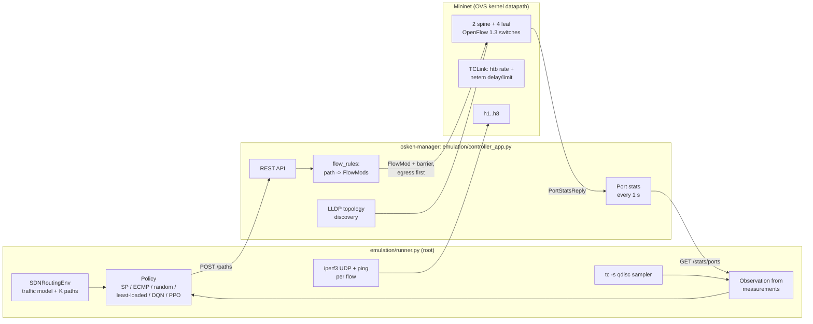

# Emulation: Mininet + os-ken

This document describes how the routing policies are run on an emulated network: what was built,
how to set it up, the decisions taken, and how the emulation differs from the simulator.
Results are in [experiments/mininet_experiment/](../experiments/mininet_experiment/README.md).

## Architecture



Modules (all under `emulation/`, none imported by the backend):

| Module | Needs | Purpose |
|---|---|---|
| `mapping.py` | backend only | Simulator names → Mininet names, dpids, port numbers, interfaces, scaled capacities; written to `mapping.json` for every run |
| `topology.py` | Mininet, root | Builds the network from the mapping |
| `controller_app.py` | os-ken or Ryu | OpenFlow 1.3 app: drop table-miss, path rules, port stats, REST API |
| `controller_client.py` | stdlib | REST client; starts `osken-manager` |
| `session.py` | Mininet, root | Controller + network lifecycle; checks that LLDP discovery matches the mapping |
| `traffic.py` | Mininet for running, parsing is pure | iperf3 UDP flows and pings |
| `verify_paths.py` | tshark for capturing, checking is pure | Checks captured packets against installed paths |
| `milestone.py` | everything | Controller milestone (phase 1) |

The rule logic shared with the backend is `backend/app/controller/flow_rules.py` (pure Python).

## Environment setup

Tested on WSL2 (kernel 6.18.54.1-microsoft-standard-WSL2), Ubuntu 24.04.1, Python 3.12.3.

```bash
# Kernel modules (not loaded automatically after a WSL restart)
printf 'openvswitch\nsch_htb\nsch_netem\nsch_tbf\n' | sudo tee /etc/modules-load.d/mininet.conf
sudo modprobe -a openvswitch sch_htb sch_netem sch_tbf

# Mininet 2.3.0, Open vSwitch 3.3.9, iperf3 3.16, tshark 4.2.2, os-ken 2.8.1 (Ubuntu 24.04 packages)
sudo apt install mininet openvswitch-switch openvswitch-testcontroller iperf3 tshark python3-os-ken

sudo mn --link tc --test pingall
```

`modprobe` loads only its first argument unless given `-a`; the other names are taken as module
parameters (`modprobe openvswitch sch_htb ...` loads only `openvswitch`).

`openvswitch-switch` starts under WSL with systemd enabled (`systemctl is-active openvswitch-switch`
→ `active`).

The runner needs root (Mininet) and the backend's Python packages. It is run with the backend
virtualenv's interpreter under `sudo`; the apt package installs Mininet for the system Python only,
so `emulation/_compat.py` appends `/usr/lib/python3/dist-packages` to `sys.path` (after the
virtualenv's own packages) when `import mininet` fails. The controller runs under the system
Python (`/usr/bin/osken-manager`).

## Decisions

### Controller: os-ken

- **os-ken 2.8.1** from Ubuntu's `python3-os-ken` runs on the system Python 3.12 and has Ryu's API
  under `os_ken.*`; the entry point is `osken-manager` (checked in the installed package).
- os-ken does **not** ship Ryu's REST applications. Neither the Ubuntu package nor PyPI `os-ken`
  4.2.2 contains `os_ken.app.ofctl_rest`, `rest_topology`, `simple_switch_13` or the `wsgi` app;
  `os_ken/app/` contains only `ofctl` (the in-process API). The emulation app therefore serves its
  own small REST API with `os_ken.lib.hub.WSGIServer` (eventlet) and a stdlib-only WSGI handler.
- Ryu 4.34 was installed in a separate Python 3.9 environment only to test the backend's existing
  `FlowManager`, which talks to Ryu's `ofctl_rest` (see "Existing install_path code" below).
- `controller_app.py` and `backend/app/controller/openflow_handler.py` import from `os_ken` and
  fall back to `ryu`; both were checked to import under os-ken 2.8.1 and Ryu 4.34.

### Forwarding: proactive, IPv4, no flooding

- Table-miss drops. No L2 learning or flooding: a spine-leaf topology has loops, and without
  spanning tree a flood would circulate. Hosts get static ARP entries (`autoStaticArp`), so no ARP
  traffic is needed, and IPv6 is disabled on the hosts.
- One rule per switch and direction: match `eth_type=0x0800, ipv4_src, ipv4_dst`; output to the
  next hop's port; priority 100; no idle or hard timeout. Every flow connects a distinct host
  pair, so IPv4 addresses identify the flow; its pings and iperf3's TCP control connection follow
  the same path. The reverse direction gets rules on the reversed path.
- Cookie = `0x5D0 << 48 | flow_id << 1 | direction`. All path rules share the `0x5D0` prefix, so
  `DELETE /paths` removes them with one cookie-masked delete per switch.
- Path change: only rules that change are sent. New rules go egress switch first, each followed by
  a barrier (the app waits for the switch's reply); a changed rule on the same switch is overwritten
  by an ADD with the same match and priority; rules on switches the flow no longer crosses are
  deleted last (strict delete with the flow's cookie). The ingress rule is therefore the last one
  rewritten, after the rest of the new path is in place. Each sent FlowMod counts as one rule change
  ("route churn").

### Existing `install_path` code

- `FlowManager.install_path` (`ryu_controller.py`) was first run **unchanged** against Ryu 4.34
  (`ryu.app.rest_topology` + `ryu.app.ofctl_rest`) and the emulated topology
  (`experiments/mininet_experiment/phase1/flowmanager_unchanged_vs_ryu_ofctl_rest.txt`). It installed
  nothing:
  1. `rest_topology` reports dpids as 16-digit hex strings, so nodes are named `s0000000000000065`.
     `int(node.lstrip("s"))` read spine1 (0x65 = 101) as decimal 65, and skipped leaves such as
     `s00000000000000c9` (not all digits).
  2. ofctl_rest answered 404 for dpid 65; `add_flow` only caught `httpx.RequestError`, so the
     `HTTPStatusError` escaped instead of returning `False`.
  3. Ports are also hex strings (`"00000003"`), which ofctl_rest cannot convert (HTTP 500).
  4. Ryu discovers hosts only from packet-ins, so a path ends at the egress switch, which never got
     a rule.
  5. Rules matched only MAC addresses and expired after 300 s idle.
- Fixed: `TopologyManager` parses hex dpids and ports; `FlowManager` builds its rules with
  `flow_rules` (IPv4 match, permanent, cookie, egress first) and takes an `egress_port` when the
  path ends at a switch; HTTP error statuses count as failures. Against Ryu it then installed rules
  on all 3 hops of h1 → h5 and back, and ping succeeded 3/3
  (`phase1/flowmanager_fixed_vs_ryu_ofctl_rest.txt`). Ryu's ofctl_rest sends no barrier between
  rules, so its egress-first order is best effort.
- `openflow_handler.py`: `install_path` had the same MAC-only, idle-timeout rules; it now uses
  `flow_rules`. Its `_CONTEXTS = {"wsgi": SimpleSwitch13}` would have started a second L2 learning
  app under the name "wsgi" and was removed.

### Topology mapping

- Mininet nodes keep the simulator's names. Datapath ids are set explicitly to the generator's
  (spine1 = 101, spine2 = 102, leaf1..4 = 201..204): Mininet would otherwise derive dpid 1 for both
  spine1 and leaf1 from the digits in their names.
- Every link uses the generator's port numbers (spine *i* port *j* ↔ leaf *j* port *i*; hosts on
  leaf ports 3 and 4), so `spine1-eth3` is OpenFlow port 3 of spine1. At startup the session checks
  that LLDP discovery finds exactly these links and ports.
- Host IPs are the generator's (`192.168.<leaf>.<n>`), configured with a /16 prefix so all hosts are
  on one subnet.
- Switch links: `TCLink` with htb rate = simulator bandwidth × capacity scale, netem delay = the
  simulator's 5 ms, netem limit = 25 packets. Host access links are not modelled in the simulator,
  so they are plain veth links without shaping.

## Verification (phase 1)

`sudo <venv>/bin/python -m emulation.milestone --out experiments/mininet_experiment/phase1`:

- all 6 switches connect; LLDP finds the 16 directed links on the mapped ports;
- 4 flows installed through the REST API (via spine1, via spine2, a five-switch detour through both
  spines, and a same-leaf flow) appear in `dump-flows` on every hop (`dump_flows_initial.txt`);
- tshark on all 8 spine interfaces (snaplen 96) during 2 s of traffic: 4/4 flows only on their
  installed paths (`verify_initial.txt`, `capture_initial.pcapng`);
- moving h1 → h5 from spine1 to spine2 sent 6 FlowMods (per direction: add on spine2, rewrite on
  leaf1, delete on spine1); spine1 no longer has the flow's rules (`dump_flows_after_change.txt`),
  and the capture again shows 4/4 flows on their paths (`verify_after_change.txt`).

`tc -s qdisc` / `tc -s class` of spine1-eth1: htb class `rate 10Mbit ceil 10Mbit`, netem child
`limit 25 delay 5ms` (`tc_spine1-eth1.txt`).
