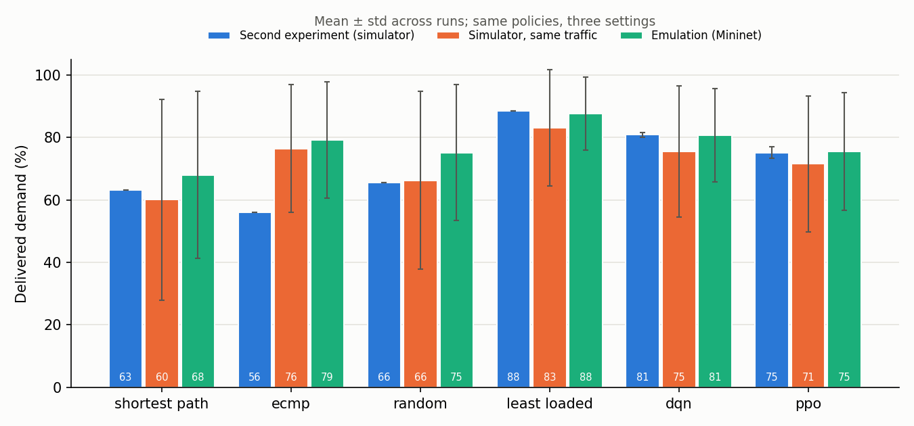

# Mininet Experiment: Simulator-Trained Policies on an Emulated Network

Run on 2026-10-30, branch `feature/mininet-emulation` (script at commit `18a85e3`; the analysis
script was extended afterwards with the fluid-model and iperf3-failure tables, and re-run on the
same raw data).

**Question.** Do the routing policies trained in the flow-level simulator keep their ranking against
the baselines when they are deployed, without retraining, on a packet-level emulated network?

**Short answer.** On this topology and traffic, mostly yes. Least-loaded stays first and shortest
path last. DQN stays ahead of shortest path and random routing. Its position relative to ECMP flips
(ECMP ahead by 0.9 points in the simulator, DQN ahead by 1.6 in the emulation), and both differences are small compared
with the spread between traffic seeds. Every policy delivers more in the emulation than the
simulator predicts. That gap comes from two simplifications in the simulator's link model, not from
packet-level effects.

## Setup

| | |
|---|---|
| Network | Mininet 2.3.0, Open vSwitch 3.3.9 (kernel datapath, OpenFlow 1.3), WSL2 kernel 6.18.54.1 |
| Controller | os-ken 2.8.1 (maintained Ryu fork), app `emulation/controller_app.py`: proactive IPv4 rules per flow, REST API, port statistics every 1 s |
| Topology | spine-leaf, 2 spine + 4 leaf switches, 8 hosts, as in the [second experiment](../second_experiment/README.md). Switch links 200 Mbit/s × 0.05 = **10 Mbit/s**, 5 ms netem delay, 25-packet queue; host links unshaped |
| Traffic | `SDNRoutingEnv`'s traffic model, traffic seeds 1000, 1001, 1002; 16 flows. Demands × 0.05, sent as iperf3 UDP (1000-byte payload) paced by the kernel `fq` qdisc |
| Epoch | 1 environment step = 10 s of traffic. Delivered demand, loss and link features are measured in the window [2 s, 9 s]. RTT comes from 5 pings/s per flow. One warm-up epoch on shortest paths, then 20 epochs |
| Policies | shortest path, ECMP (CRC32 hash of the 5-tuple over the equal-cost candidates), random, least-loaded; DQN and PPO from the second experiment (model seeds 0, 1, 2; no retraining) |
| Agent input | the 67-dimensional observation built from measurements: port counters, tc queue statistics and netem configuration. See [docs/emulation.md](../../docs/emulation.md#simulator-vs-emulation-the-observation-features) |
| Runs | 30 main runs: 4 baselines × 3 traffic seeds, plus 2 agents × 3 model seeds × 3 traffic seeds. 9 stress runs |
| Duration | 14:09 to 16:38, 2 h 30 min for all 39 runs (3.4 to 4.2 min each) |

The trained models are not in the repository. They are the ones from the second experiment, and
`experiments/scripts/evaluate.py` with them reproduces that experiment's `eval_seed_*.json`
exactly.

### Simulator on the same traffic

`emulation/sim_matched.py` runs every policy in `SDNRoutingEnv` on the same traffic seeds, for the
same 20 steps, with the policies observing the simulator. The demand sequence is the same in both,
and it does not depend on routing: the runs' logged demands are identical across policies for each
seed. The comparison with the emulation is therefore paired.

## Results

All numbers below are copied from [summary.md](summary.md), which `python -m emulation.analyze`
generates from the raw runs in `runs/`.

### Delivered demand and ranking

Mean ± standard deviation across runs: 3 runs per baseline, 9 per agent.

| Policy | Second experiment (sim) | Simulator, same traffic | Emulation | Emulation p95 RTT (ms) | Emulation loss (%) | FlowMods / epoch |
|---|---|---|---|---|---|---|
| shortest path | 63.1 (#5) | 60.0 ± 32.2 (#6) | 68.0 ± 26.7 (#6) | 36.4 ± 12.8 | 33.0 ± 26.9 | 0.0 |
| ECMP | 56.0 (#6) | 76.4 ± 20.5 (#2) | 79.1 ± 18.7 (#3) | 32.4 ± 9.0 | 21.7 ± 19.1 | 1.9 |
| random | 65.5 (#4) | 66.3 ± 28.3 (#5) | 75.1 ± 21.7 (#5) | 62.1 ± 21.2 | 26.1 ± 22.0 | 68.6 |
| least-loaded | 88.4 (#1) | 83.0 ± 18.7 (#1) | 87.6 ± 11.7 (#1) | 37.8 ± 2.8 | 13.6 ± 12.6 | 24.3 |
| DQN | 80.8 (#2) | 75.5 ± 20.9 (#3) | 80.7 ± 14.9 (#2) | 45.0 ± 11.9 | 20.1 ± 15.3 | 22.1 |
| PPO | 75.1 (#3) | 71.5 ± 21.8 (#4) | 75.5 ± 18.9 (#4) | 46.0 ± 12.1 | 25.3 ± 19.1 | 14.1 |

Spearman rank correlation of the policy means:
- emulation vs simulator on the same traffic: **0.94**;
- emulation vs second experiment: 0.66.



Per traffic seed, as simulator on the same traffic / emulation, in %. Agent cells are means over 3
model seeds:

| Policy | seed 1000 | seed 1001 (light) | seed 1002 (heavy) |
|---|---|---|---|
| shortest path | 52.0 / 54.2 | 95.5 / 98.7 | 32.6 / 51.0 |
| ECMP | 74.0 / 75.8 | 98.0 / 99.2 | 57.2 / 62.3 |
| random | 66.3 / 71.6 | 94.6 / 98.3 | 37.9 / 55.3 |
| least-loaded | 86.6 / 86.9 | 99.6 / 99.6 | 62.8 / 76.3 |
| DQN | 76.9 / 76.1 | 98.8 / 99.2 | 50.8 / 66.8 |
| PPO | 66.3 / 65.3 | 98.1 / 99.1 | 50.0 / 62.0 |

On each traffic seed, the Spearman correlation between simulator and emulation ranks is 0.94: one
adjacent pair swaps per seed.
- Seed 1000: PPO and random swap. Random gains 5.3 points in the emulation, PPO loses 1.0.
- Seed 1001: ECMP and PPO swap, all policies within 1 point, between 98.3% and 99.6%.
- Seed 1002: ECMP and DQN swap.

### Run quality checks

- **iperf3 results:** 0 flow-epochs without a result in the 30 main runs (9,600 flow-epochs).
- **Rule updates:** in every run, the FlowMods the controller sent equal the rule changes predicted
  from the old and new paths.
- **Path checks:** in epoch 3 of traffic seed 1000, tshark on all 8 spine interfaces saw each of the
  16 flows only on its installed path. This held for every policy (6/6).
- **Host CPU:** mean 2.1%, maximum 25.8% over all main runs, measured on the whole WSL VM. The 25.8%
  happened during the ECMP run with traffic seed 1000, while an unrelated `pip install` ran in
  Windows. That run's delivered demand (75.8%) is 1.8 points above the simulator's prediction for
  the same decisions, in line with the other runs.
- **Observation range:** every observation stayed within [0, 1], 67 dimensions.

### netem stress test

In the stress runs, both directions of spine1-leaf4 get +20 ms delay and 2% random loss from
epoch 5 on. Before = epochs 0-4, after = epochs 5-19.

| Policy | Traffic seed | Delivered before / after (%) | p95 RTT before / after (ms) | Demand share on the link before / after | FlowMods / epoch after |
|---|---|---|---|---|---|
| shortest path | 1000 | 63.2 / 49.1 | 35.2 / 74.3 | 0.52 / 0.54 | 0.0 |
| shortest path | 1001 | 100.0 / 94.7 | 23.7 / 62.0 | 0.48 / 0.46 | 0.0 |
| shortest path | 1002 | 57.8 / 48.3 | 49.0 / 75.2 | 0.41 / 0.41 | 0.0 |
| least-loaded | 1000 | 99.6 / 80.6 | 32.2 / 61.0 | 0.26 / 0.25 | 27.2 |
| least-loaded | 1001 | 100.0 / 99.0 | 40.9 / 61.3 | 0.29 / 0.24 | 19.3 |
| least-loaded | 1002 | 86.1 / 72.3 | 40.3 / 74.2 | 0.18 / 0.18 | 24.4 |
| DQN (model seed 0) | 1000 | 87.0 / 72.6 | 45.2 / 73.1 | 0.47 / 0.45 | 15.5 |
| DQN (model seed 1) | 1001 | 100.0 / 98.7 | 40.3 / 60.3 | 0.37 / 0.27 | 30.5 |
| DQN (model seed 2) | 1002 | 70.6 / 65.1 | 52.7 / 75.0 | 0.18 / 0.21 | 29.6 |

None of the three policies moves traffic away from the degraded link in a consistent way.
- **Least-loaded** routes on demand only and cannot see the link degrade.
- **DQN** sees the higher latency and loss in its observation. Its demand share on the link falls
  on seed 1001 (0.37 to 0.27). On seed 1000 it barely changes (0.47 to 0.45), and on seed 1002 it
  rises (0.18 to 0.21).

The agents were never trained with a degraded link, so this is not a fair test of what an agent
could learn. It does show that the deployed policies do not route around a lossy link on their own.

In the stress runs, 29 of 2,880 flow-epochs have no iperf3 result. The 2% netem loss can drop
iperf3's UDP setup datagram, and that flow then sends nothing in that epoch. Such flow-epochs are
left out of delivered demand; [summary.md](summary.md) lists them per run.

## The gap between simulator and emulation

### Delivered demand

For the same routing decisions and demands, the emulation delivers on average **5.9 points more**
than the simulator predicts. The difference is largest under heavy load: up to 30 points in single
epochs on traffic seed 1002. Two simplifications in the simulator's link model account for almost
all of it:

1. **Shared capacity.** The simulator gives a link one capacity for both directions. The emulated
   links, like real Ethernet, are full-duplex: each direction has the full 10 Mbit/s.
2. **No downstream thinning.** In the simulator, a flow gets the smallest capacity/offered share
   along its path, computed from all flows' full demands. In the network, traffic dropped at an
   upstream link no longer loads the downstream links.

Recomputing delivered demand for every epoch of the main runs with fluid models (`emulation/analyze.py`):

| Link model | Mean difference to emulation (points) | Mean absolute difference | Max absolute difference |
|---|---|---|---|
| simulator: shared capacity, min share | −5.89 | 5.91 | 30.17 |
| per-direction capacity, min share | −0.77 | 0.91 | 4.92 |
| per-direction capacity, drops thin downstream load | −0.02 | 0.27 | 4.80 |

With both changes, a fluid model predicts the emulated delivered demand to within 0.27 points on
average, over 600 epochs. For delivered demand with constant-rate UDP at this scale, the
packet-level network adds nothing that a corrected fluid model misses. The ranking holds because
the simulator's error is roughly a uniform underestimate. The error grows with load, and policies
that overload more links (shortest path, random) gain the most: +8.0 and +8.8 points.

### Observation features

The agents were trained on the simulator's link features and receive measured ones in the
emulation. The table below compares both for the same routing and demands, over 4,800
link-epochs:

| Feature | Simulator mean | Measured mean | Mean absolute difference | Correlation |
|---|---|---|---|---|
| utilization | 0.574 | 0.532 | 0.046 | 0.95 |
| latency (ms) | 11.7 | 7.5 | 4.2 | 0.63 |
| packet loss (%) | 0.31 | 5.79 | 5.77 | 0.57 |
| queue occupancy | 0.447 | 0.124 | 0.323 | 0.63 |

- **Utilization** matches well.
- **Loss** is outside the training distribution: the simulator never reports more than 1%, while
  real overloaded links drop tens of percent (normalized and clipped at 5%).
- **Queue occupancy:** the simulator reports half-full queues at half load. The measured queues are
  nearly empty until a link saturates.

These differences cost the agents little here. The simulator can score the decisions the agents made
in the emulation, which used measured observations, and compare them with the agents' decisions
on the simulator's own observations for the same demands:
- **DQN:** 75.1% with measured observations vs 75.5% with the simulator's;
- **PPO:** 69.5% vs 71.5%.

A likely reason is that both agents mainly react to utilization and demand, the features that
transfer.

### What this does not show

- **Spread between seeds.** Three traffic seeds is few, and their loads differ a lot (seed 1001 is
  light: every policy delivers 94% or more). The standard deviations in the main table mostly
  reflect load, not policy quality. The paired per-seed table is the better comparison. The
  DQN/ECMP and PPO/random orderings are not resolved by this data in either setting.
- **ECMP** is implemented differently here (5-tuple hash) than in the second experiment
  (round-robin over the 4 candidate paths). This explains ECMP moving from last to second or third,
  and most of the lower correlation with the second experiment. It is not an emulation effect.
- **Least-loaded** uses the simulator's heuristic on the known demands, not measured port
  statistics, in both settings.
- **Limits of the emulation:**
  - UDP at constant rate only: no TCP congestion control, which is where packet-level behavior
    would differ most from a fluid model;
  - one small topology at 10 Mbit/s;
  - traffic pauses between epochs while rules change, so transient effects of updates on live
    traffic are not measured.
- **Agent stability.** Route churn differs:
  - PPO's FlowMods per epoch vary widely across model seeds (14.1 ± 14.7);
  - random routing changes about 69 rules per epoch, and its p95 RTT is the highest.

  RTT is not part of the reward the agents were trained on.

## Reproduce

Linux with Mininet, Open vSwitch, iperf3, tshark and os-ken (setup in
[docs/emulation.md](../../docs/emulation.md#environment-setup)), the models from the second
experiment in `<models dir>/seed_{0,1,2}/{dqn,ppo}_model.pt`, from the repository root:

```bash
sudo bash experiments/mininet_experiment/run.sh ~/venvs/rlsdn/bin/python ~/second_experiment_models
# tables and figure only, from the committed raw runs:
python -m emulation.analyze experiments/mininet_experiment
```

`run.sh` skips runs that already have a `summary.json`, so it can be resumed.

## Files

| Path | Content |
|---|---|
| `run.sh` | the full experiment |
| `summary.md`, `results.json`, `delivered.png` | tables, the same numbers as JSON, figure (generated by `emulation.analyze`) |
| `sim_matched.json` | the simulator on the same traffic (`emulation.sim_matched`) |
| `runs/main/<policy>[_m<model seed>]_t<traffic seed>/` | one directory per run: `args.json`, `mapping.json`, `controller.log`, `controller_topology.json`, `epochs.jsonl.gz` (every epoch: paths, demands, per-flow iperf3 and ping results, per-link measured and simulated features, observation, CPU), `summary.json`, `tc_qdisc_{start,end}.txt`, `runner.out`, `verify_<policy>.txt` (tshark check) |
| `runs/stress/...` | the same for the stress runs, plus `stress_tc.json` |
| `phase1/`, `phase2/`, `phase3/` | controller milestone and the short development runs that preceded the experiment |

Packet captures of the main runs (1.2 to 2.9 MB each) are written to `/tmp` and deleted after the path check. Only the
phase-1 capture is committed.
